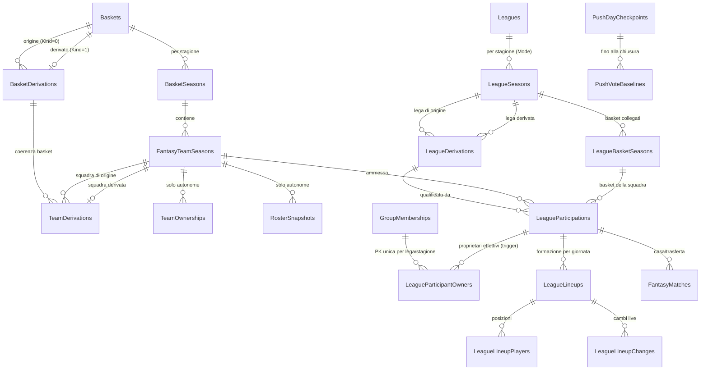

# ADR 0012 — Cache distribuita su Blob, competizioni multi-squadra e retention push

- Data: 2026-10-28
- Stato: implementato sul branch `refactor/postgresql-multi-group` (migration `20261028230852_MultiTeamCompetitionsAndOperationalCache`, MappingVersion importer 45; correzioni successive alla revisione del 30 ottobre: migration `20261030180752_OfficialVoteRevisions`); da validare sul dump reale prima del cutover.

## Contesto

Prima della migrazione definitiva servono, una sola volta e sul nuovo stack: una cache condivisa per i dati operativi che non hanno valore storico, uno snapshot Live per gruppo, basket e leghe derivati, formazioni distinte per competizione e il vincolo "un utente controlla al massimo una squadra per lega e stagione". PostgreSQL resta l'unica fonte autorevole dei dati di gioco persistenti.

## Decisioni

### 1. `IDistributedCache` su Azure Blob Storage

- Provider `AzureBlobDistributedCache` (`src/Fantasoccer.Infrastructure.Storage/Caching`), registrato con `AddAzureBlobDistributedCache`. Implementa `Get/Set/Refresh/Remove` sincroni e asincroni e le tre scadenze di `DistributedCacheEntryOptions`.
- Un Blob per voce, nel container **privato** `Cache:ContainerName` (default `fantazone-cache`, verificato all'avvio: un container pubblico è rifiutato). Il contenuto è il JSON UTF-8 dell'applicazione; la scadenza logica sta nei **metadati del Blob** (`fzcache`, `createdat`, `absoluteexpiration`, `slidingexpiration`, `lastaccess`, `expiresat`), così la pulizia non scarica i contenuti. Una voce scaduta ma ancora presente fisicamente è una cache miss; metadati illeggibili o assenti sono una cache miss.
- Sliding expiration: la lettura riscrive solo i metadati (con `If-Match`) e soltanto dopo `Cache:SlidingRefreshRatio` (10%) della finestra; nessuna scrittura a ogni lettura. Le cache ad alta frequenza usano comunque scadenze assolute. Il tempo passa da `TimeProvider`.
- Retry: backoff esponenziale dell'SDK per gli errori transitori; i conflitti condizionali sono restituiti al chiamante che ha un proprio ciclo limitato.
- `IDistributedCache` non è un lock né un CAS. Per questo il provider implementa anche `Fantasoccer.Caching.IDistributedCacheCoordinator` (Domain): `GetEntryAsync` (valore + ETag), `TrySetAsync` condizionale (`If-Match`/`If-None-Match`, una voce scaduta vale come assente), `TryAcquireLeaseAsync` (lease Blob 15–60 s, rinnovato in background, mai permanente: alla perdita del rinnovo il token `LeaseLost` annulla la pubblicazione) e `PurgeExpiredAsync`.
- Doppio livello in `SharedSnapshotCache` (Application.Core): L1 `IMemoryCache` per istanza con TTL breve (`Cache:Shared:MemoryTimeToLive`, 5 s) e L2 distribuito. L1 è solo un'ottimizzazione.
- Envelope versionato `CacheEnvelope<T>`: `schemaVersion`, `kind`, `generatedAtUtc`, `freshUntilUtc`, `sourceRevision`, `sourceFingerprint`, `payload`. Nessun token, PAT, connection string o segreto nei documenti.
- Pubblicazione **monotona**: CAS sull'ETag con al massimo `PublishAttempts` tentativi e backoff con jitter; una revisione più vecchia non sostituisce mai una più nuova (`SkippedNewerExists`), una identica è idempotente (`Unchanged`).
- **Un documento identico non si riscrive.** Con il soft delete attivo sull'account ogni sovrascrittura lascia una copia nascosta per l'intero periodo di conservazione, e le regole di lifecycle non toccano gli oggetti già in soft delete. Per gli snapshot che rispecchiano una sorgente esterna `sourceFingerprint` è l'hash SHA-256 del payload: se il contenuto è lo stesso, `PublishAsync` non scrive (`Unchanged`) e lo riconferma soltanto a intervalli (`confirmEvery`: 5 min per i voti Live, 1 h per le probabili formazioni), così `generatedAtUtc` resta onesto come «ultima conferma». Qualsiasi cambio di contenuto si pubblica subito. Anche l'esito di un `merge` (recupero di un rinvio) è confrontato sul contenuto finale.
- Stale-while-revalidate controllato: una sola istanza rigenera sotto lease; le altre servono la proiezione precedente **marcata `isStale`** solo entro `maxStale` (2 min per il Live) oppure attendono al massimo `RegenerationWait` e poi calcolano localmente senza pubblicare. Nessuna lettura resta bloccata indefinitamente.
- In host `InMemory`/test si usa `InMemoryCoordinatedDistributedCache`, con la stessa semantica (testata con gli stessi casi del provider Blob su Azurite).
- Ambienti: `Cache:Namespace` (default: nome dell'ambiente in minuscolo) è il primo segmento di ogni percorso; ambienti che condividono lo storage account non collidono.

#### Chiavi logiche e percorsi Blob

| Dato | Chiave logica | Blob | TTL fisico | Freschezza |
| --- | --- | --- | --- | --- |
| Probabili formazioni/indisponibili | `football:v1:{season}:day-DD:chances` | `{ns}/football/v1/{season}/day-DD/chances.json` | 35 giorni | 12 h (inutilizzabili dopo 30 giorni senza conferma) |
| Voti Live provvisori | `football:v1:{season}:day-DD:live-votes` | `{ns}/football/v1/{season}/day-DD/live-votes.json` | 21 giorni | 10 min (sempre utilizzabili, segnalati se in ritardo) |
| Live del gruppo | `live:v1:{groupId:N}:{season}:day-DD` | `{ns}/live/v1/{groupId}/{season}/day-DD.json` | 3 giorni | fingerprint |
| Lock di rigenerazione | `{chiave}:regeneration` | `{ns}/_locks/{sha256}.lock` | lease 15–60 s | — |

Le chiavi calcistiche non contengono il gruppo (dato globale). Una chiave con caratteri fuori da `[a-z0-9._-]` viene trasformata in `{ns}/_hashed/{sha256}.json` e non può uscire dal proprio namespace.

#### Pulizia e lifecycle

- Job SQL `cache-cleanup` (giornaliero 04:20 Europe/Rome): `PurgeExpiredAsync` con 1 giorno di grazia, cancellazione condizionata all'ETag osservato; lock Blob non in lease rimossi dopo `LockBlobRetention` (1 giorno). Il limite (5000) riguarda le **cancellazioni** per esecuzione, non le voci esaminate: i Blob ancora validi non fermano la scansione. Restano il cancellation token e il timeout del job.
- Protezione aggiuntiva: lifecycle policy Azure in [`ops/azure/cache-lifecycle-policy.json`](../ops/azure/cache-lifecycle-policy.json): elimina i documenti non modificati da 45 giorni (oltre il TTL fisico massimo, 35 giorni) e, se il versioning è attivo, versioni e snapshot **attivi** dopo 1 giorno. **Non** riguarda il soft delete: una cancellazione o una sovrascrittura con soft delete attivo crea una copia nascosta che resta per tutto il periodo configurato a livello di account (7 giorni in `infra/storage.tf`, non escludibile per container) e che le regole di lifecycle non toccano. Per questo i documenti della cache non vengono riscritti quando il contenuto non cambia (vedi sopra); con questa regola un documento riscritto ogni minuto per una giornata intera superava le 1000 copie per Blob, soglia oltre la quale Microsoft sconsiglia di andare. Se dopo la misura le copie risultano ancora molte, la via è un account storage dedicato alla cache senza soft delete.

### 2. Probabili formazioni e voti Live

- Un solo snapshot globale per stagione e giornata (`IFootballLiveDataStore`), scritto dai job `chances` e `live` con la **validazione invariata**: una sorgente vuota, ambigua o con voti non finiti produce 409 e lo snapshot precedente resta. Priorità invariata: flag in OR fra Fantagazzetta, Gazzetta e Injury; stato e descrizione dall'ultima sorgente che riporta il giocatore (Injury ultima).
- La revisione è l'istante del fetch: un job lento che pubblica dopo uno più recente viene scartato. Il recupero di un rinvio pubblica in **merge** soltanto i club interessati, nella chiave della giornata originale.
- **Freschezza esplicita.** `generatedAtUtc` è l'ultima conferma del contenuto e `freshUntilUtc` quanto resta valida (`CacheEnvelope.IsFreshAt`). Tre stati: *fresco*, *non aggiornato ma disponibile*, *inutilizzabile* (assente, illeggibile o di schema diverso: cache miss). I voti Live restano utilizzabili anche se non aggiornati, perché sono l'ultimo dato provvisorio di quella giornata e i voti ufficiali li sostituiscono; le probabili formazioni non confermate da più di 30 giorni sono trattate come assenti (meglio nessun dato che un dato sbagliato; il job aggiorna solo la giornata in corso o la prossima, quindi una giornata passata conserva le sue ultime probabili formazioni per quel periodo). `GET .../votes/live` e `GET .../chances` espongono `updatedAtUtc` e `isStale` (omessi per i dati su SQL). Il Live del gruppo segnala `liveVotesStale` solo mentre la giornata si gioca (dal primo calcio d'inizio a 10 h 15 dall'ultimo, la stessa finestra del job `live`): fuori da quella finestra nessun job gira e l'ultima conferma è semplicemente lo stato finale.
- Consumer unici: `SqlFootballMatchdayReader` (punteggi, anteprime, AIgoritmo), API `votes/live` e `chances` (contratto invariato), `MatchdayPushProducer`. Checkpoint e baseline delle notifiche restano su PostgreSQL. I voti ufficiali restano su PostgreSQL; nessun voto Live completa risultati storici.
- Le tabelle `FootballChances` e le righe `FootballVotes` con `Source = Live` restano nello schema ma non sono più scritte né lette: la loro eliminazione sarà una migration esplicita successiva alla validazione.

### 3. Live delle competizioni per gruppo

`LiveCompetitionApplicationService` costruisce un `LiveGroupSnapshot` (leghe, giornate, partite in vista `GameDto` senza `CanEdit`, voti, punteggi e risultati provvisori, classifica salvata) condiviso dagli utenti autorizzati del gruppo. A ogni richiesta si calcola un fingerprint SQL leggero delle sorgenti (revisione del gruppo, versioni dei calendari, partecipazioni, lineup e rose del giorno, partite reali, **revisione dei voti ufficiali**, **hash del contenuto** degli snapshot calcistici, fase temporale); se coincide si serve la proiezione, altrimenti una sola istanza la ricostruisce. Il fingerprint non è memoizzato: una memoizzazione di 2 s produceva letture stantie dopo una scrittura.
La revisione dei voti ufficiali è `FootballDayRevisions.OfficialRevision` per stagione e giornata, incrementata da trigger a livello di istruzione su `FootballVotes` (insert, update e delete, solo `Source = Official`, righe aggiornate in ordine di chiave): vale per qualunque scrittore (ingestione, importer, SQL diretto) e conta ogni campo del voto. Un salvataggio senza modifiche non scrive nulla e quindi non la incrementa. Una prima versione sommava voto, gol, assist e stato: due correzioni opposte (6→7 e 6→5) o una modifica a un altro campo non invalidavano la proiezione. Degli snapshot calcistici conta l'hash del contenuto e non l'orario di pubblicazione, quindi una semplice riconferma non ricostruisce il Live di tutti i gruppi.
La vista di sola lettura di una partita della giornata Live (`GET .../games/{id}` con `editMode=view`) usa la stessa proiezione; le modalità di modifica sono sempre calcolate per il chiamante. La proiezione non scrive classifiche; la perdita della cache comporta solo una ricostruzione.

### 4. Basket e leghe autonomi/derivati

- `Baskets.Kind` (0 autonomo, 1 derivato) con chiave alternativa `(GroupId, BasketId, Kind)`. `BasketDerivations` collega un basket derivato a **un** basket di origine: le colonne costanti `DerivedKind = 1` e `OriginKind = 0` partecipano alle FK composite, quindi il database rifiuta un'origine derivata (niente catene, quindi niente cicli) e il cambio di tipo di un basket collegato.
- `TeamDerivations`: squadra derivata → una squadra di origine dello stesso gruppo e stagione, nel basket di origine dichiarato (FK composite). Unica per origine e basket. Immutabile (trigger).
- Copia carbone = condivisione permanente: la squadra derivata non ha rosa, proprietari, crediti, asta o mercato propri (trigger `fz:derived_team_roster`, `fz:derived_team_ownership`); legge sempre la rosa corrente dell'origine. Acquisti e vendite sono immediatamente visibili. Nessun job di copia.
- `Leagues.Mode` (autonoma/derivata) è distinto dal legacy `IsMain` (autorità economica/regolamento fra leghe che condividono un basket, invariato). Una lega autonoma usa basket autonomi, una derivata basket derivati (trigger). La modalità non cambia dopo i collegamenti.
- `LeagueDerivations`: una lega derivata può dipendere da più leghe di origine dello stesso gruppo e stagione (FK composita), con numero di qualificate ed eventuale stage; un trigger serializzato da advisory lock rifiuta i cicli.
- `LeagueParticipations`: squadre effettivamente ammesse, con provenienza (`BasketEnrollment`, `Manual`, `Qualification`, `Legacy`), lega di origine e posizione. Le leghe autonome iscrivono esplicitamente le squadre dei basket collegati quando si crea il collegamento o la squadra; le derivate solo per qualificazione confermata o selezione manuale. Una partecipazione confermata non segue i cambi di classifica; non si ritira se esistono partite o formazioni. `FantasyMatches` referenzia le partecipazioni.

### 5. Un utente, una squadra per lega e stagione

`LeagueParticipantOwners` ha PK `(GroupId, LeagueId, SeasonIndex, UserId)` ed è mantenuta da trigger nella stessa transazione di ogni modifica a proprietà, comproprietà, derivazioni e partecipazioni (per una derivata valgono i proprietari dell'origine). Copre proprietario+proprietario, proprietario+comproprietario e comproprietario+comproprietario, anche per SQL diretto e scritture concorrenti (la PK risolve la corsa). La violazione diventa `409 league_owner_conflict`. Lo stesso utente può possedere squadre in basket diversi del gruppo.

### 6. Formazioni per competizione e copia

- `LeagueLineups` (+ giocatori e cronologia cambi) per `(GroupId, LeagueId, SeasonIndex, TeamId, Day)`: solo posizioni, sovrapposte alla **rosa del giorno** della squadra autorevole (`RosterSnapshots` Matchday, condivisa e mai duplicata per lega). Senza lineup vale la posizione legacy della rosa del giorno (dati importati).
- Salvataggio, Live, cambi live (contatore per competizione), scadenze, regole della lega, ruoli/panchina (`TeamChecker`) e versioni concorrenti sono validati in un solo percorso. `PUT /api/teams/formation` con kind giornaliero è instradato qui; la rosa del giorno condivisa non è più una formazione modificabile.
- Copia formazione (`POST .../games/{id}/formation/copy`, `POST .../lineups/copy`, `GET .../lineups/copy-sources`): solo fra competizioni con la stessa squadra autorevole; trasferimento una tantum che passa per tutte le validazioni del bersaglio.
- Cronologia delle formazioni: la cronologia per competizione registra solo i cambi live (quelli che consumano i cambi della partita), con autore, ora e giocatori spostati. I salvataggi pre-partita, le copie e la preparazione automatica aggiornano la formazione senza voci di cronologia.
- Ultima formazione mostrata: aprendo (in modifica, prima del calcio d'inizio, da proprietario) una giornata senza formazione propria e con rosa tutta in tribuna, il server mostra direttamente l'ultima formazione della stessa squadra nella stessa competizione (`proposedFromDay`, senza riquadro di conferma). In lettura non scrive nulla: diventa la formazione della giornata al salvataggio o quando il job di preparazione la crea; anche il calcolo dei punti, se manca la formazione e la rosa è tutta in tribuna, usa la stessa ultima formazione invece della penalità (rete di sicurezza; i risultati già salvati restano invariati finché non si ricalcola).
- Formazione condivisa per default (`GET/PUT /api/teams/lineup-settings`, tabella `TeamLineupSettings`): la stessa squadra autorevole ha la stessa formazione in tutte le sue competizioni. Ogni salvataggio pre-partita, in qualunque competizione, viene copiato nelle altre una per una con tutte le validazioni del bersaglio; un rifiuto (scadenza, regole) è riportato nel messaggio e non annulla il salvataggio. I cambi live non si propagano. Se il proprietario sceglie «formazione diversa per ogni competizione» (impostazione della squadra, per stagione), non si copia nulla e la schermata della partita mostra il cambio di competizione (`copy-sources` con `gameId`) accanto a «Copia formazione». Solo il proprietario di quella squadra può cambiare l'impostazione.
- Giocatori venduti dopo il salvataggio: segnalati in `unavailablePlayerIds`, mai corretti silenziosamente; un giocatore acquistato entra in tribuna. Le partite giocate restano negli snapshot storici e le giornate iniziate non sono modificabili.
- Risultati, automazione della giornata successiva (una lineup per competizione con partita, AIgoritmo con le regole di quella lega), notifiche dei cambi live (ricevute per lega) e AIgoritmo con `teamId` (anche in modalità SuperAdmin) usano la lineup della competizione.

### 7. Push: retention senza archivio

Outbox, ricevute, lease, retry e deduplicazione restano su PostgreSQL. `PushRetentionService` chiude una giornata conclusa (tutte le partite finite o oltre 135′ dal calcio d'inizio, nessun rinvio o risultato fantasy pendente) dopo `PushRetention:Retention` (48 h): imposta `PushDayCheckpoints.ClosedAtUtc` (il checkpoint resta e i produttori non emettono più eventi per quella giornata), poi elimina baseline voti, ricevute dei cambi formazione, voti legacy `Notification` del giorno, delivery terminate o scadute non in lease con ricevute e conferme di ambito. Le delivery di mercato (giorno 0) restano deduplicate da `MarketTradeEvents`. Preferenze, dispositivi, dati di gioco e righe in elaborazione non sono toccati. Gira alla preparazione della nuova giornata (8 h prima) indipendentemente dall'invio di promemoria e nel job giornaliero `push-retention`. I job girano solo per la stagione corrente, quindi ogni esecuzione ripulisce anche ciò che le stagioni precedenti ancora contengono: una giornata rimasta aperta (risultato fantasy mai finalizzato, delivery oltre la finestra) viene chiusa senza attendere risultati pendenti, con la stessa regola di sicurezza (mai sotto lease, mai ciò che è ancora consegnabile) e senza creare checkpoint per giornate che avevano solo delivery. L'esito di trasporto `Delivered` è rinominato `ProviderAccepted` (accettazione del servizio Web Push, non lettura); le ricevute storiche `Delivered` hanno lo stesso significato (`PushOutcomes.IsProviderAccepted`).

### 8. Migration e importer

- Migration EF Core senza `EnsureCreated`, ID preservati. Il backfill rende esplicita la regola legacy (ogni squadra dei basket collegati partecipava) con `Source = Legacy`; fallisce con `league_owner_conflict` e le coordinate da riconciliare se i dati esistenti violano il vincolo.
- Importer (MappingVersion 45): partecipazioni legacy esplicite, rifiuto `league_owner_conflict` alla fine dell'analisi, nessuna derivazione inventata, nessuna proprietà attribuita. Voti Live e probabili formazioni restano verificati nel dump e riportati in `operationalSnapshotsNotImported`; solo la giornata del cutover può essere pubblicata in cache con `seed-operational-cache` (revisione = inizio export, quindi mai sopra dati più recenti del provider).

### 7. Login social interno (senza Rystem.Authentication.Social)

- Il flusso non cambia: il frontend invia il codice Entra ID (PKCE) a `/api/Authentication/Social/Token?provider=2`, l'API verifica l'identità, usa l'email normalizzata per trovare (o creare) l'account e **rilascia il proprio bearer token** (24 ore) e il **refresh token (365 giorni)**. Il refresh passa da `provider=0` con lo stesso endpoint e solo dall'origine del frontend che l'ha ottenuto. `/api/Authentication/Social/User` e i formati di risposta restano identici.
- L'implementazione è in `Fantasoccer.Business/Authorization/Social` (contratti in `Fantasoccer.Domain/Identity/SocialContracts.cs`): `SocialLoginBuilder` (client id e origini consentite), un `ISocialCodeExchanger` per provider (Microsoft, refresh) e gli endpoint. Nessun pacchetto Rystem Social; dalla pulizia descritta in ADR 0013 restano solo DependencyInjection e Concurrency (più Rystem core transitivo).
- L'ID token Microsoft ora è verificato nella firma (chiavi dei metadati, in cache), nella scadenza, nell'emittente (tenant dei consumer) e nel destinatario (il nostro client id); prima emittente e destinatario erano controllati solo più avanti dal provider utente.
- Per aggiungere Google: registrare un `ISocialCodeExchanger` con chiave `ProviderType.Google` che restituisca un `TokenResponse` con l'email verificata e le impostazioni in `SocialLoginBuilder.Google`; il provider utente e l'emissione dei token non cambiano.

## Diagramma ER (nuove relazioni)

## Conseguenze e rischi

- Il vincolo per lega può bloccare la migration o l'import su dati reali: va riconciliato esplicitamente (nessuna scelta automatica).
- La pubblicazione monotona dipende dagli orologi delle istanze (revisione = istante del fetch); lo scarto atteso è trascurabile rispetto alla cadenza dei job.
- Lease Blob: durata minima 15 s; la scadenza reale dei lease non è riprodotta nei test (solo rilascio ed esclusività).
- Il fingerprint Live costa alcune query per richiesta (la revisione dei voti ufficiali è una lettura per chiave); la ricostruzione completa avviene solo al cambio delle sorgenti. Il carico reale (query SQL, latenza, richieste Blob con molti utenti sullo stesso Live) va misurato prima di valutare una revisione condivisa aggiornata dagli eventi.
- Le tabelle operative legacy (`FootballChances`, voti `Live`) restano fino a una migration di rimozione esplicita.
