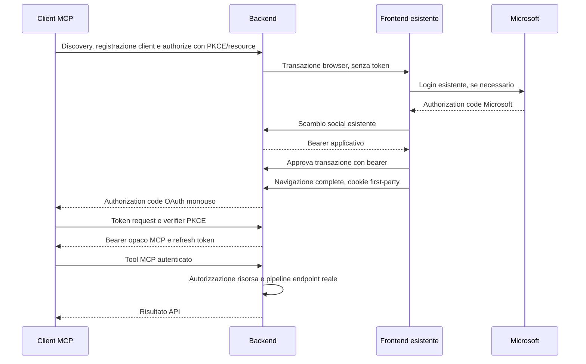

# Fantasoccer MCP e client OAuth

## Stato e architettura

La feature è **disabilitata per default** (`Mcp:Enabled=false`). Non richiede un nuovo progetto o deployment.

- Endpoint MCP Streamable HTTP: `/mcp`, SDK C# ufficiale `2.3.0`, stateless.
- OpenIddict `7.7.2`: Authorization Code con PKCE **solo S256**, registrazione dinamica dei client (RFC 7591), refresh e revoca. I client preregistrati restano opzionali.
- Persistenza OAuth nello **stesso account Azure Blob Storage** dei repository Rystem, senza database SQL/SQLite o Entity Framework.
- Login Microsoft esistente: il frontend ottiene il normale bearer e approva il collegamento con quello.
- Gli access token OAuth usano **lo stesso `BearerTokenProtector` ASP.NET Core del frontend**, non un nuovo formato JWT. Sono nuove emissioni, con identità applicativa, audience MCP e scope `fantasoccer.full_access`.
- La connessione consente letture, scritture e amministrazione secondo i permessi dell'account, non soltanto tre tool read-only.
- I bearer del frontend non vengono copiati in ChatGPT. I token MCP non sono accettati come credenziali di login/consenso né sulle URL legacy: le operazioni passano dalla facade.



## Configurazione minima

Configurare tramite impostazioni di hosting, variabili d'ambiente o user-secrets; non committare password, PFX o token.
Esempio **da adattare**, non una configurazione produttiva già attiva:

```json
{
  "Mcp": {
    "Enabled": true,
    "PublishAllTools": false,
    "Issuer": "https://api.example.com",
    "FrontendUrl": "https://frontend.example.com/",
    "DataProtectionKeyPath": "/PERCORSO_PERSISTENTE_ESISTENTE_VERIFICATO"
  }
}
```

- `Issuer`: origine HTTPS pubblica del backend, senza path/query/fragment. L'hosting sotto un path base non è supportato da questa prima versione.
- `FrontendUrl`: frontend web aggiornato con `McpConnectionGate`. L'origine viene aggiunta alla policy CORS.
- `Mcp__CertificateBase64`: PFX in Base64, tramite secret manager/ambiente; in alternativa usare `CertificatePath`, non entrambe le sorgenti. `Mcp__CertificatePassword` è la password di esportazione del PFX. Il certificato deve avere chiave privata, essere valido e idoneo a firma e cifratura. La pipeline usa il Base64 direttamente, senza file PFX nell'artefatto pubblico e senza dipendere dal sistema operativo dell'App Service.
- Non servono client ID, client secret o callback globali: ogni applicazione compatibile si registra automaticamente. Non serve una registrazione per utente, chat, squadra o tool.
- I client comunicano le proprie redirect durante la registrazione: URI HTTPS **esatte**, mai wildcard, frammenti o credenziali; è ammesso HTTP solo sul loopback per applicazioni locali. Durante authorize OpenIddict verifica la corrispondenza con quelle registrate. Non vengono scaricati URL o documenti metadata forniti dal client.
- Viene riutilizzata `ConnectionStrings:Storage`, già presente per l'infrastruttura: **nessuna nuova connection string OAuth**. L'app prepara i container privati `mcp-oauth` (documenti) e `mcp-keys` (key ring); l'identità storage deve poter creare/leggere/elencare/scrivere/eliminare blob. L'avvio viene bloccato se uno di questi container è pubblico. Non renderli pubblici e non applicare policy di cancellazione indiscriminata.
- Le chiavi Data Protection persistenti sono indispensabili anche se si usa un PFX OAuth: proteggono i bearer opachi. `DataProtectionBlobName` salva il key ring nel container `mcp-keys`, cifrato con il certificato configurato. Il key ring si applica all'intera applicazione: **migrare le chiavi già usate dall'hosting prima di cambiarne lo store**, per non invalidare sessioni frontend esistenti. In alternativa è ancora supportato `DataProtectionKeyPath` per conservare un percorso persistente già in uso, ma non impostare entrambe le opzioni. Le repliche devono leggere le stesse chiavi con lo stesso discriminatore Data Protection e avere il certificato necessario a decifrarle.
- Conservare copie protette del key ring e del PFX. La rotazione del certificato richiede conservare/configurare anche i certificati di decifratura precedenti: non sostituire semplicemente il PFX cancellando quello vecchio.
- Dopo l'attivazione, disabilitare MCP non deve rimuovere la configurazione Data Protection: il codice conserva store e certificato configurati anche con `Mcp:Enabled=false`, per leggere le sessioni frontend protette dalle nuove chiavi. Non cancellare certificato/password o cambiare discriminatore durante la disabilitazione. Il rollback a binari precedenti richiede una verifica separata della decifratura delle chiavi.
- In `Development`/`Testing` sono ammesse chiavi OAuth effimere senza PFX: codici/refresh diventano invalidi al riavvio. In produzione la configurazione incompleta impedisce l'avvio, anziché esporre un endpoint non protetto.
- Non cambiano ClientId, permessi Microsoft o modello utenti del login social attuale.

### Persistenza, concorrenza e repliche

I documenti OAuth usano l'envelope `Entity<OAuthDocument,string>` di Rystem in un repository **non esponibile**. Le letture passano dal repository; le liste usano il prefisso del tipo per non leggere entità non pertinenti. Poiché l'update Blob standard di Rystem non supporta compare-and-swap, `BlobOAuthDocumentStorage` esegue solo le scritture condizionali con l'SDK Azure (`If-None-Match` per insert, versione del documento e `If-Match`/ETag per update). Un conflitto diventa `OpenIddictExceptions.ConcurrencyException`, non una sovrascrittura silenziosa.

Codici, refresh, grant e transazioni browser sono condivisi tra istanze. Il consenso attraversa stati monouso `pending → approved → completed → redeemed`, con CAS a ogni transizione; persiste solo l'email, non i bearer o i privilegi. Le cache delle entità OpenIddict sono disabilitate per rendere osservabili le revoche tra repliche. L'avvio usa ID deterministici per gli eventuali client preregistrati e gestisce la registrazione concorrente. I client dinamici ricevono ID casuali generati dal server e persistiti nello stesso storage.

`McpRedeemTokenHandler` impone, al momento del riscatto di code e refresh, stato ancora valido e CAS riuscito. Questo copre anche richieste già autenticate mentre un'altra replica consuma il token, e rende più restrittiva la tolleranza di OpenIddict ai conflitti refresh concorrenti.

La persistenza OAuth non richiede sticky session se account storage, issuer, client, certificati e Data Protection coincidono tra le repliche. Questo **non rende automaticamente distribuita tutta l'applicazione**: hub/aste SignalR e rate limiter mantengono i propri vincoli preesistenti. I limiti di traffico qui sono locali all'istanza: per un limite globale usare anche il gateway dell'hosting.

La retention elimina in modo condizionale i documenti temporanei: consensi dopo scadenza + 1 giorno, token dopo scadenza + 7 giorni, record revocati/cancellati dopo 7 giorni. I grant validi e i client non vengono eliminati. Il job gira all'avvio e ogni 6 ore, tollera esecuzioni concorrenti e non cancella aggiornamenti più recenti. I token vengono comunque rifiutati alla scadenza: la retention non è il controllo di validità.

## Registrazione e collegamento da qualsiasi client compatibile

1. Verificare backend e frontend aggiornati in locale e, se disponibile, su un ambiente di prova. Il rilascio può attivare subito MCP solo dopo il preflight completo.
2. Nell'applicazione che consente server MCP personalizzati, inserire `https://api.example.com/mcp` e scegliere OAuth/registrazione automatica. In produzione l'URL è `https://apifc.azurewebsites.net/mcp`.
3. Il client scopre `registration_endpoint` dai metadata OAuth e invia le proprie callback a `POST /connect/register`. Non copiare callback o segreti nei GitHub Secrets. Il client conserva le credenziali restituite per la propria registrazione.
4. Richiedere `fantasoccer.full_access`; aggiungere `offline_access` per il rinnovo automatico, se previsto dalla configurazione del client.
5. Collegarsi: login Microsoft esistente, consenso esplicito, ritorno all'app. Il nome del client è autodichiarato e viene indicato come non verificato: approvare solo collegamenti avviati dall'utente con un'app fidata.
6. Provare prima `get_my_account`, poi consultazione di una lega; verificare una scrittura innocua e un'operazione amministrativa con account distinti.

Il codice non installa un'app nel catalogo ChatGPT e non abilita funzioni mancanti nel piano/workspace. Il collegamento reale Microsoft/ChatGPT richiede configurazione e verifica manuale con account reali, non sostituibile dai test locali.

La registrazione implementa RFC 7591 con `authorization_code`, opzionalmente `refresh_token`, `response_type=code` e autenticazione `none`, `client_secret_basic` (default RFC) o `client_secret_post`. PKCE S256 è obbligatorio anche per client riservati. I secret vengono generati dal server, restituiti una sola volta e salvati con l'hashing di OpenIddict. I metadata sconosciuti non attribuiscono privilegi e non vengono scaricati; ID e secret scelti dal chiamante sono ignorati. Non sono implementati aggiornamento/cancellazione pubblica delle registrazioni (RFC 7592) o Client ID Metadata Documents: non viene pubblicizzato supporto per questi protocolli.

Esempio per un client pubblico locale (di norma è l'app a inviare la richiesta):

```http
POST /connect/register
Content-Type: application/json

{"client_name":"Il mio client MCP","redirect_uris":["http://127.0.0.1:49152/callback"],"token_endpoint_auth_method":"none","grant_types":["authorization_code","refresh_token"],"response_types":["code"]}
```

La risposta `201` contiene un `client_id` generato. La registrazione non dà accesso ai dati: occorrono comunque account esistente e consenso. I client senza registrazione dinamica possono essere preregistrati opzionalmente con `Mcp:Clients`; questo è un fallback, non un requisito per gli altri client. Le app browser ricevono CORS non credentialed sui soli endpoint MCP/discovery/registrazione/token/revoca; consenso e API legacy mantengono la policy SPA esistente. L'Origin di una chiamata MCP autenticata deve corrispondere alla callback del suo client oppure all'origine API/frontend.

### GitHub environment `production`

Il workflow `deploy-api.yml` legge questi valori:

| Tipo | Nome | Valore |
| --- | --- | --- |
| Variable | `MCP_ENABLED` | `true` per il rilascio con MCP attivo; `false` per disabilitarlo |
| Variable | `MCP_ISSUER` | `https://apifc.azurewebsites.net` |
| Variable | `MCP_FRONTEND_URL` | `https://fanta.zone/` |
| Secret | `MCP_CERTIFICATE_PFX_BASE64` | PFX con chiave privata codificato Base64 |
| Secret | `MCP_CERTIFICATE_PASSWORD` | Password di esportazione del PFX |
| Variable | `MCP_KEY_RING_REVIEWED` | `true` **solo dopo** verifica/conservazione/migrazione delle chiavi e del discriminatore attuali |
| Variable | `MCP_DATA_PROTECTION_KEY_PATH` | Percorso persistente **già usato e verificato**, oppure usare l'opzione Blob seguente |
| Variable | `MCP_DATA_PROTECTION_BLOB_NAME` | Nome del key ring **già migrato** nel container privato `mcp-keys`, alternativo al percorso |

Le due variabili dello store sono alternative; è possibile ometterle se la corrispondente impostazione `Mcp__DataProtectionKeyPath` o `Mcp__DataProtectionBlobName` è già configurata in Azure. L'assenza di entrambe le impostazioni in Azure non identifica il percorso effettivo: verificare il default dell'hosting prima di configurarlo esplicitamente. Non impostare `MCP_KEY_RING_REVIEWED` per aggirare il controllo.

Verifica in sola lettura del 24 ottobre 2026: `apifc` è un App Service Linux e la directory persistente `/home/ASP.NET/DataProtection-Keys` contiene 13 file di chiavi preesistenti (verificati solo nomi/path e metadati, non il contenuto). Per questo hosting si può mantenere `MCP_DATA_PROTECTION_KEY_PATH=/home/ASP.NET/DataProtection-Keys`, senza migrazione su Blob. Il codice non imposta un nuovo application name/discriminatore e il deployment mantiene la directory applicativa esistente. Conservare backup protetti e verificare le sessioni già aperte dopo il rilascio; non cancellare i file della directory.

Le variabili `MCP_CLIENT_ID`, `MCP_CLIENT_DISPLAY_NAME`, `MCP_REDIRECT_URI`, le varianti `MCP_CHATGPT_*` e il secret `MCP_CLIENT_SECRET` non sono più usati dalla pipeline; possono essere rimossi o lasciati inutilizzati. Certificato e password già preparati restano validi.

Prima di qualsiasi scrittura Azure lo script di deploy controlla configurazione, key-ring review e apertura del PFX con la password. Se la verifica manca, il deploy si ferma senza cambiare le impostazioni o distribuire l'API. Non viene creato/migrato automaticamente un nuovo key ring. Il PFX è passato direttamente come App Setting segreta, senza essere inserito nel publish; le impostazioni non vengono stampate nei log né passate in chiaro negli argomenti della CLI. Non ruotare certificato o chiavi esistenti con questa procedura.

## Tool e copertura delle API

Per default vengono pubblicati sei tool:

1. `get_my_account`: identità, gruppi, selezioni salvate (anche storiche) e stagione corrente; nessun parametro utente arbitrario. I campi precedenti `email`, `username`, `groups`, `state` sono conservati; `savedSelections` e `currentSeason` aggiungono contesto leggibile.
2. `list_api_operations`: catalogo ricercabile/paginato con identificatore operazione, route, verbo, annotazione di scrittura, schemi input/risposta e contratto della chiave di ogni repository/factory.
3. `execute_api_operation`: esecuzione per identificatore di catalogo, con `query`, `route`, `body` e/o `files`.
4. `get_current_season`: data UTC server, indice e label della stagione corrente, confini temporali e convenzioni delle giornate.
5. `get_fantasoccer_guide`: guida tematica a stagioni, JSON, gruppi, formazioni, mercato, aste, risultati, competizione iniziale, amministrazione e funzioni personali. Con `topic=models` elenca i modelli esposti con filtro/paginazione.
6. `describe_api_model`: nomi JSON compatti → proprietà estese, significato, tipo, riferimenti ai modelli annidati, flag di sola lettura, schema e valori enum effettivamente serializzati (numeri o stringhe).

Questo evita di inviare centinaia di schemi a ogni connessione. `PublishAllTools=true` pubblica anche un tool per ogni operazione per i client che lo supportano; non è necessario per avere accesso all'intero catalogo.

Il catalogo deriva da ApiExplorer: controller applicativi e repository **effettivamente esposti**. Conserva varianti/factory di repository, route parameter, parametri query e body. Non pubblica login, emissione token, metadata, Swagger, repository `SetNotExposable` o URL scelte dal modello.

### Contesto applicativo fornito al client

Durante l'handshake MCP il server invia `instructions` che indirizzano il modello alla guida, alla stagione corrente e al proprio account. La guida resta consultabile tramite tool anche per i client che non usano le istruzioni iniziali; non è necessario incollare la documentazione in ogni chat. I metadata non concedono accesso ai dati: tutte le letture/scritture applicative continuano ad attraversare i controlli esistenti.

Gli alias sono **specifici del modello**: ad esempio `Team.p=Players`, `Player.p=Price`, `AppIdentity.g=Groups`, `TeamKey.g=Group`. Il dizionario e le descrizioni negli schemi derivano dai contratti JSON .NET reali, incluse proprietà ereditate e attributi `JsonIgnore`; non viene creato un formato di storage/API alternativo. I valori enum sono serializzati con lo stesso contratto (es. `IdentityRole.Admin=4`, `AuctionCommand.PlaceBid="PlaceBid"`). Le spiegazioni semantiche aggiungono unità, flussi e avvertenze per i campi principali.

La navigazione è incrementale: richiedere `get_fantasoccer_guide(topic="models", filter="Team", offset=0, limit=20)` e poi `describe_api_model(model="Fantasoccer.Team")`. `list_api_operations` restituisce `inputModels`, `responseSchemas[].models` e, per i repository, `repository.model`, `keyType`, `factory` e `keySchema`. Il grafo dei modelli deriva solo dai contratti delle operazioni esposte, non da uno scan di opzioni OAuth, credenziali o repository interni. Gli endpoint con risposta dichiarata `object`/`IActionResult` non diventano magicamente tipizzati: il catalogo segnala il limite; consultare guida e discovery dei comandi d'asta per le risposte dinamiche.

### Stagione corrente e storico

Il nuovo endpoint autenticato **`GET /Context/GetCurrentSeason`** è disponibile anche alle API normali, ed esposto via catalogo MCP; `get_current_season` fornisce gli stessi dati senza dover scoprire la route.

```json
{
  "serverTimeUtc": "2026-10-24T12:00:00+00:00",
  "currentSeason": {
    "seasonIndex": 15,
    "label": "2026/27",
    "fullLabel": "2026/2027",
    "startYear": 2026,
    "endYear": 2027,
    "startsAtUtc": "2026-08-10T00:00:00+00:00",
    "endsAtUtcExclusive": "2027-08-10T00:00:00+00:00",
    "firstGlobalDayId": 533,
    "lastGlobalDayId": 570
  }
}
```

Esempio abbreviato: la risposta reale contiene anche le regole di interpretazione. La data viene calcolata a ogni richiesta con il clock server, non fissata al deploy. `FantacalcioTime.ActualYear` e il contesto usano la stessa funzione: **2012/13=1**, cambio il **10 agosto alle 00:00 UTC**. `year`/`y` sono normalmente indici stagionali, non `2026`/`2027`; il contesto corrente non modifica la selezione storica salvata dell'utente.

Giornata Serie A (1..38), numero turno fantasy e dayId globale sono distinti: `(seasonIndex-1)*38+SerieADay`. Le stagioni disponibili si verificano su `League.Years`/`Basket.Years`. La stagione corrente non implica una partita live, una finestra formazione aperta o dati già configurati; leggere i calendari e i vincoli server.

### Uso da ChatGPT dopo l'aggiornamento

Se la connessione è stata creata prima dei nuovi tool, aggiornare/scansionare nuovamente gli strumenti nella gestione dell'app ChatGPT (se il workspace conserva uno snapshot del catalogo). Avviare una nuova chat selezionando l'app e chiedere: «Leggi la guida di Fantasoccer e la stagione corrente; poi dimmi a quali gruppi appartengo, senza modificare dati». Gli altri client possono dover riconnettersi o aggiornare `tools/list`. Non occorrono nuovi secrets, callback o registrazioni manuali.

Esempio (recuperare sempre l'identificatore effettivo dal catalogo):

```json
{
  "operation": "IDENTIFICATORE_RESTITUITO_DAL_CATALOGO",
  "arguments": {
      "query": { "key": "{\"g\":\"gruppo\",\"l\":\"lega\",\"y\":15}" }
  }
}
```

Le chiavi composite sono le stesse stringhe JSON accettate dalle API, non nuove chiavi MCP. Gli schemi descrivono i nomi JSON dei modelli esistenti.

Gli upload usano `files: { nomeParametro: { fileName, contentType, base64 } }`; la facade ricostruisce il multipart. Limite per file 2 MiB, body/risposta facade 4 MiB, richiesta MCP 8 MiB. Le API mantengono gli ulteriori limiti già presenti. Non vengono effettuati download da URL fornite dal modello.

### Come viene riutilizzata la business logic

`McpApiFacade` costruisce un `HttpContext` isolato e attraversa routing, autorizzazione e delegate degli endpoint originali nello stesso processo. Vengono eseguiti model binding, filtri MVC, policy, autorizzazione repository e business hook esistenti. Non chiama direttamente repository bypassando gli endpoint e non effettua richieste HTTP verso host selezionabili dall'utente.

Le risposte riportano `statusCode`, `contentType`, `encoding` e `body`; il body conserva il contratto originale (UTF-8 per testo/JSON, base64 per contenuti binari). Le risposte HTTP di errore sono tool error. Un eventuale fallimento business rappresentato da un payload HTTP 200 resta nel payload originale: il client deve leggerlo, non presumere successo dal solo status.

### Aste SignalR

Il nuovo adapter `McpAuction/Invoke` richiama gli stessi metodi di `AuctionHub`: offerte, gestione giocatori, timer, chiusura/riapertura, ruoli e altri comandi dichiarati nell'enum `AuctionCommand`.

Prima chiamare `McpAuction/Commands` per conoscere i parametri dei comandi. Il chiamante viene sempre dal principal autenticato; non è possibile fornire un `HubCallerContext` arbitrario. Il gruppo viene controllato prima dell'invocazione e restano i controlli auctioneer/owner nel metodo originale. Le notifiche al caller diventano risposta; i broadcast raggiungono i client SignalR reali.

Non viene aperta una connessione SignalR persistente per ChatGPT: non riceve automaticamente eventi futuri o un timer in streaming. Per osservare nuovi eventi deve effettuare una nuova lettura.

## Autorizzazione e cambiamenti intenzionali

- L'utente deriva solo dal ticket validato. Le claim applicative vengono ricaricate per ogni richiesta MCP: una demozione non attende la scadenza del token.
- Il ruolo globale `super_admin` dipende dall'email dell'account configurato nel provider esistente, **non da `Username` modificabile**.
- Le letture di gruppo richiedono membership attiva; scritture amministrative richiedono il ruolo nel gruppo autorevole.
- Le scritture generiche dei documenti `Team` (stagionali, giornalieri e competizione iniziale) richiedono un ruolo amministrativo **nel gruppo autorevole**. Proprietà/comproprietà non autorizza a cancellare giocatori, venderli, cambiarne prezzo/stato o riscrivere crediti. Le formazioni passano dai controller dedicati, che copiano solo le posizioni sulla rosa server; i trasferimenti passano dal mercato o dal flusso amministrativo/asta autorizzato. Batch/bootstrap generici delle squadre sono bloccati.
- Gli admin di gruppo possono cercare/provisionare identità come nel frontend, ma modificare solo membership di gruppi che amministrano, senza attribuirsi `SuperAdmin`.
- Un utente ordinario può aggiornare il proprio stato/profilo, non le proprie membership o i ruoli.
- Bulk/batch/bootstrap e query non circoscrivibili a un gruppo sono riservati al super-admin globale; le query delle identità restano disponibili agli amministratori verificati per mantenere il workflow admin esistente.
- I repository non esposti dal backend non diventano automaticamente accessibili via MCP.
- Le operazioni GET che modificano dati (es. creazione calendario, ricalcoli) **non** vengono marcate read-only.

I confini su `AppIdentity`, `Group`, `LeagueManager` e scritture generiche `Team` si applicano anche alle URL HTTP legacy, **anche con MCP disabilitato**: altrimenti si potrebbero modificare rosa o documenti di autorizzazione da una seconda superficie. È un hardening intenzionale: chiamate prima ammesse per la sola presenza di un'email possono ora restituire 403. Provare i workflow admin con i dati reali prima del rilascio in produzione. La modifica di nome, logo e altre preferenze resta disponibile attraverso i controller personali esistenti.

Inoltre il frontend usa ora verifier PKCE casuali per transazione, verifica `state` e invia il verifier nel body supportato da Rystem. Il provider applicativo controlla issuer `consumers` e audience sulle claim Microsoft verificate dalla libreria. Il contratto di access token/refresh del frontend non cambia.

## Durata e revoca

- Access token MCP: 24 ore; refresh OAuth: 30 giorni.
- I refresh token ruotano senza finestra di riuso: non inviare refresh concorrenti e non ripetere automaticamente uno scambio dall'esito incerto. Il rilevamento del replay può richiedere un nuovo collegamento.
- `/connect/revoke`: revoca OAuth standard, per access/refresh token del client.
- `POST /connect/disconnect` con il **bearer frontend** e `{ "clientId": "fantasoccer-chatgpt" }`: revoca tutte le concessioni di quel client per l'utente autenticato.
- La revoca della concessione invalida subito gli access token MCP già emessi e impedisce refresh; non disconnette gli altri utenti né elimina i bearer frontend.
- Il logout frontend continua ad avere il significato attuale: non revoca automaticamente i collegamenti ChatGPT.
- Nelle impostazioni del frontend, **Collegamenti MCP** elenca i client autorizzati e permette la revoca con conferma. Usa `GET /connect/connections` e `POST /connect/disconnect` con il bearer frontend; non espone token o secret. Se MCP è disabilitato la sezione non viene mostrata.

Non vengono registrati gli argomenti dei tool o le credenziali nei log della facade. Gli errori inattesi restituiscono un riferimento, non eccezioni complete. Configurare anche proxy/Application Insights per non raccogliere token o query sensibili del login legacy.

Rate limiting: 120 richieste/minuto per origine IP sulle superfici MCP/OAuth, senza coda; registrazione limitata ulteriormente a 30 richieste/minuto per IP e body di 16 KiB (massimo 10 redirect). Non fidarsi di `X-Forwarded-For` arbitrari; configurare il reverse proxy con gli indirizzi fidati del proprio hosting. La registrazione aperta può creare record persistenti anche senza consenso: monitorare traffico e crescita dello storage; i limiti sono per istanza, non una protezione globale contro abusi distribuiti.

## Test

```bash
dotnet test src/Fantasoccer.Tests/Fantasoccer.Tests.csproj --filter "FullyQualifiedName~Tests.Api"
```

Nella directory frontend:

```bash
npm test
npx tsc --noEmit
```

I test API condividono un solo host (RepositoryFramework mantiene stato statico per la registrazione endpoint) e normalmente uno store OAuth in memoria con lo stesso contratto CAS, snapshot isolati e retention. Il login Microsoft è simulato con un bearer emesso dallo stesso protector, non con credenziali reali. Sono coperti consenso/browser binding, riavvio del servizio, transizioni concorrenti, PKCE e replay, riscatto concorrente del code, refresh, revoca, token frontend, isolamento, scritture, ruoli, upload e adattatore aste.

Per eseguire gli stessi test contro **Blob reale/Rystem**, avviare Azurite su una porta libera e impostare `FANTASOCCER_TEST_OAUTH_BLOB` alla sua connection string (o a un account di test dedicato), poi eseguire i test MCP. Non usare mai l'account di produzione: il test retention può eliminare documenti di test scaduti. Non occorre un emulatore SQL.

```bash
docker run --rm --name fantasoccer-mcp-azurite -p 127.0.0.1:11000:10000 \
  mcr.microsoft.com/azure-storage/azurite:3.35.0 \
  azurite-blob --blobHost 0.0.0.0 --skipApiVersionCheck
# In un altro terminale: esportare la connection string Azurite con BlobEndpoint sulla porta 11000.
dotnet test src/Fantasoccer.Tests/Fantasoccer.Tests.csproj --filter "FullyQualifiedName~Mcp"
```

### Checklist prima dell'abilitazione online

- [ ] Verificare backend e frontend insieme; usare staging se già disponibile. Con `MCP_ENABLED=true` il preflight deve essere completo prima di qualsiasi modifica dell'App Service.
- [ ] Verificare `ConnectionStrings:Storage`, container privati, permessi, backup e migrazione del key ring corrente.
- [ ] Configurare issuer HTTPS pubblico, URL frontend, certificato e key ring verificato. Non occorre configurare callback per client con registrazione dinamica.
- [ ] Il proxy deve preservare lo schema HTTPS e non bufferizzare le risposte MCP; configurare solo proxy fidati, non fidarsi di header forwarded arbitrari.
- [ ] Abilitare la feature; verificare discovery, challenge 401 e un consenso reale Microsoft → ChatGPT.
- [ ] Provare account ordinario/admin/super-admin: lettura, modifica innocua, rifiuto cross-group e revoca da impostazioni.
- [ ] Provare refresh, riavvio API e, se usate, due repliche con lo stesso key ring. Provare separatamente i workflow aste/SignalR.
- [ ] Verificare che log/APM/proxy non raccolgano credenziali, code o payload sensibili; impostare alert su errori OAuth, 403 inattesi e retention.

Dopo il deploy è disponibile uno smoke test **senza credenziali e senza scritture**:

```bash
python3 scripts/check-mcp.py https://api.example.com
```

Controlla discovery HTTPS, endpoint OAuth pubblici e rifiuto 401 della chiamata MCP anonima; non effettua login e non sostituisce il collaudo autenticato.

Restano obbligatori il login Microsoft reale e il collegamento nel workspace ChatGPT target. I test locali ed Azurite non certificano la configurazione dei domini o i permessi del workspace. Nessun deploy o modifica a risorse di produzione viene effettuato da questi test.
