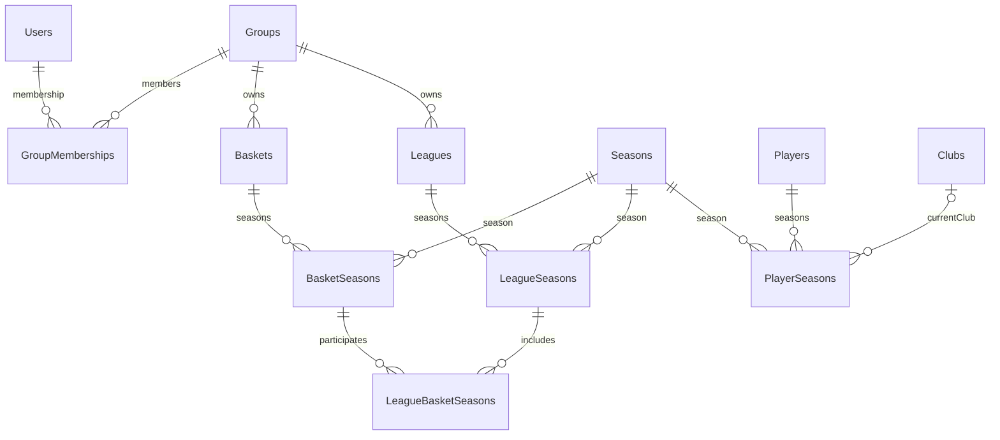

# Laboratorio locale di migrazione

Sono disponibili schema relazionale di base, test PostgreSQL ed export/verifica/ripristino locale dei dati Blob/Table.
È disponibile l'[import strutturale parziale](../../tools/Fantasoccer.DataMigration/README.md), non ancora la migrazione completa del gioco. Vedere [tool Storage](../../tools/Fantasoccer.StorageMigration/README.md) per ambito e limiti dell'export.
Questo laboratorio di test non avvia l'API. La persistenza di gioco resta legacy.
Per avviare l'intera applicazione con frontend, API, schema PostgreSQL e diagnostica locale usare invece il [Compose root e gli script per Docker Desktop](../../scripts/local/README.md).
Lo startup API nel nuovo Compose applica già lo schema EF, senza sostituire ancora la persistenza di gioco.

## Eseguire i test

Da root, con Docker e .NET SDK 10:

```bash
bash scripts/migration/test-local.sh
```

Oppure eseguire anche il test runner in Docker, senza SDK installato sull'host:

```bash
docker compose -f ops/migration/compose.yml --profile test run --rm tests
```

Il runner monta soltanto i progetti necessari, non configurazioni, segreti o dump dell'intero repository.
I test creano un database temporaneo con nome casuale e cancellano soltanto quello alla fine. I dati applicativi non vengono copiati né inviati a servizi esterni.
Le credenziali in Compose sono pubbliche ed esclusivamente locali, non utilizzabili in Azure.
Senza `FANTASOCCER_TEST_POSTGRES`/`FANTASOCCER_TEST_STORAGE`, `dotnet test` esegue i test offline e segnala quelli di integrazione non configurati come saltati. Lo script e il runner Docker impostano sempre le connessioni di test.

## Servizi e porte

```bash
docker compose -f ops/migration/compose.yml up -d --wait postgres azurite
docker compose -f ops/migration/compose.yml down
```

- PostgreSQL: `127.0.0.1:15432`, database `fantasoccer_migration_tests`, utente `fantasoccer_test`, password `local-test-only`.
- Azurite: Blob `11000`, Queue `11001`, Table `11002`, account dedicati `migrationtest` e `migrationrestore` con chiave di test Base64 `bG9jYWwtdGVzdC1vbmx5` (non l'account standard `devstoreaccount1`).
- Porte modificabili con `FANTASOCCER_POSTGRES_PORT`, `FANTASOCCER_BLOB_PORT`, `FANTASOCCER_QUEUE_PORT`, `FANTASOCCER_TABLE_PORT`.
- Volumi dedicati persistenti: `down` non li elimina. `down --volumes` è una pulizia esplicita e distruttiva dei soli volumi di questo laboratorio; non usarla se contengono una copia da conservare.

I test verificano anche export da Azurite, verifica offline e ripristino in un secondo account Azurite, inclusa la seconda esecuzione.
È verificato anche il percorso dump legacy -> PostgreSQL per il nucleo strutturale (account/gruppi/partecipazioni/proprietà). **Non è ancora verificato il percorso completo del gioco**: mancano gli altri dati e workflow.

## Schema iniziale

- Utenti e gruppi; membership con PK `(GroupId, UserId)` e ruoli distinti per gruppo.
- Stagioni e giocatori condivisi con PK `(PlayerId, SeasonIndex)`; club reali globali.
- Basket e leghe con identità locale al gruppo, configurazioni stagionali e associazioni con FK composite.
- Uno stesso basket stagionale può partecipare a più leghe senza essere duplicato.
- Vincoli DB contro duplicazioni, collegamenti cross-group/cross-season e cancellazioni a cascata involontarie.

Regolamenti, squadre, rose, formazioni, trasferimenti storici e altri ambiti verranno aggiunti con le relative migration dopo la caratterizzazione dei workflow legacy.
Gli ID globali sono UUID stabili; i vecchi identificatori saranno gestiti da un mapping esplicito nell'importatore, non ricostruiti dal nome.



Le due FK di `LeagueBasketSeasons` condividono le colonne `GroupId` e `SeasonIndex`: non è possibile combinare una lega di un gruppo/stagione con un basket di un altro.
Questo è un vincolo di integrità, **non un'autorizzazione di accesso**: i servizi e le policy che limiteranno letture/scritture al chiamante devono ancora essere implementati.

## EF tooling e migration

Impostare esplicitamente la connessione del laboratorio (non usare la produzione):

```bash
export FANTASOCCER_POSTGRES_CONNECTION='Host=127.0.0.1;Port=15432;Database=fantasoccer_migration_tests;Username=fantasoccer_test;Password=local-test-only'
dotnet ef database update --project src/Fantasoccer.Infrastructure.PostgreSql
dotnet ef migrations has-pending-model-changes --project src/Fantasoccer.Infrastructure.PostgreSql
```

Usare `dotnet-ef` 10.0.11, coerente con il runtime EF del progetto.
Le migration sono versionate; non usare `EnsureCreated`. L'helper `MigrateFantasoccerDatabaseAsync` è richiamato nello startup API prima di job/warm-up/traffico quando `PostgreSql:Enabled=true`, come nel Compose root.
I test verificano già la sua esecuzione concorrente, ripetuta e il ciclo di downgrade/upgrade sul database temporaneo.
Il timeout dei comandi di migration è 120 secondi: il suo dimensionamento su Azure va verificato sui dati reali.
